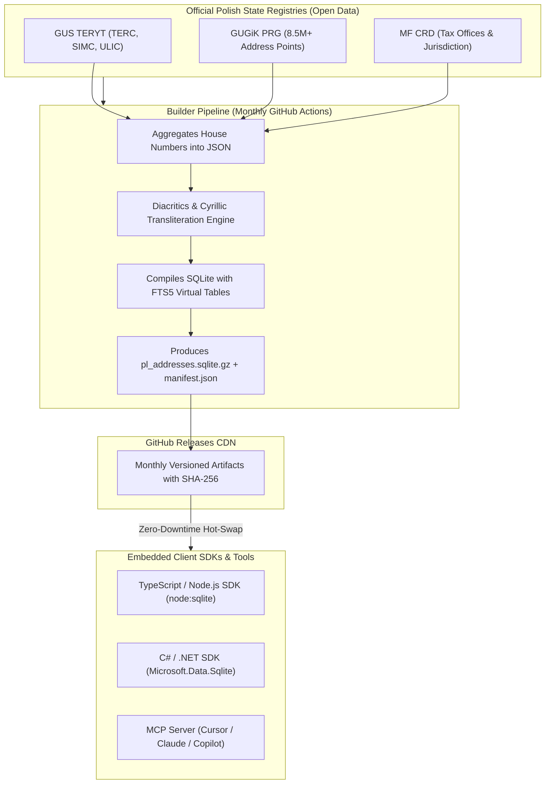

# `open-pl-address`

[](LICENSE)
[](https://www.npmjs.com/package/open-pl-address)
[](https://www.nuget.org/packages/OpenPlAddress.Sdk)
[](https://github.com/ZlamboV/open-pl-address/actions/workflows/ci.yml)
[](https://github.com/ZlamboV/open-pl-address/actions/workflows/update-db.yml)
[](packages/mcp-server)
[](#benchmarks)

**Universal Polish Address Database & Embedded SDK (TERYT + PRG + Urząd Skarbowy)**.  
High-speed in-process address search, Cyrillic transliteration, street autocomplete, house number validation, and automatic **Tax Office (Urząd Skarbowy)** determination for 100% compliance with Polish state and accounting systems (**ZUS Płatnik**, **InsERT Gratyfikant nexo**, and **PIT-11** tax declarations).

---

## Why `open-pl-address`?

| Capability | `open-pl-address` | Google Maps Geocoding API | Official GUS TERYT API |
| :--- | :--- | :--- | :--- |
| **Pricing** | **100% Free & Open-Source ($0)** | \$5.00 per 1,000 requests | Free (Requires complex registration) |
| **Query Latency** | **< 1 ms (In-process SQLite)** | 150 – 400 ms (HTTP network) | 300 – 900 ms (SOAP/XML network) |
| **Offline / Air-Gapped** | **Yes (Zero network roundtrips)** | ❌ No (Hard cloud dependency) | ❌ No (External server dependency) |
| **House Numbers (PRG)** | **Yes (8.5M+ official points)** | Partial / Inferred | ❌ No (Streets & cities only) |
| **Urząd Skarbowy (Tax)** | **Yes (Automatic 4-tier hierarchy)** | ❌ No | ❌ No |
| **Cyrillic Transliteration** | **Yes (Phonetic UA/RU -> PL)** | Inconsistent | ❌ No (Exact match only) |
| **ZUS 7-digit TERC Code** | **Yes (`terytGminaCode`)** | ❌ No | Yes |
| **Model Context Protocol (MCP)** | **Yes (`open-pl-address-mcp`)** | ❌ No | ❌ No |

---

## Architecture: Embedded Database SDK (MaxMind GeoIP Model)

Instead of slow, rate-limited, and privacy-invasive external web APIs, `open-pl-address` embeds a lightweight SQLite database directly into host applications:



1. **Central Compiler (`/builder`)**:
   Streaming pipeline downloading GUS TERYT, GUGiK PRG, and Ministry of Finance CRD XSD schemas. Aggregates 8.5M+ address points into street-level JSON maps, strips diacritics, indexes Cyrillic phonetic transliterations, and builds SQLite with FTS5.
2. **Client SDKs (`ts-sdk`, `csharp-sdk`, `mcp-server`)**:
   Operate in-process with zero network overhead. Background timers poll `manifest.json` monthly and execute atomic, zero-downtime **Hot-swaps**.

---

## Monorepo Layout

```
open-pl-address/
├── .github/
│   └── workflows/
│       ├── ci.yml                 # Continuous Integration for Node.js & .NET
│       ├── publish-npm.yml        # Automated NPM release workflow
│       ├── publish-nuget.yml      # Automated NuGet.org release workflow
│       └── update-db.yml          # Monthly automated DB compiler & release publisher
├── builder/                       # Pipeline compiling TERYT + PRG + MF CRD into SQLite
├── schema/                        # SQL migrations and schema documentation
├── packages/
│   ├── ts-sdk/                    # TypeScript/Node.js SDK (open-pl-address)
│   ├── csharp-sdk/                # C# / .NET SDK (OpenPlAddress.Sdk)
│   └── mcp-server/                # Model Context Protocol stdio server for AI agents
├── skills/
│   └── polish-address/            # AI Agent Skill (Progressive Disclosure)
├── docs/
│   └── recipes/                   # Real-world integration recipes (Telegram, Sfera, ZUS)
└── data/                          # Local database & manifest storage
    ├── pl_addresses.sqlite
    ├── pl_addresses.sqlite.gz
    └── manifest.json
```

---

## Quickstart

### 1. TypeScript / Node.js (`open-pl-address`)

```bash
npm install open-pl-address
```

```typescript
import { PolishAddressSDK } from 'open-pl-address';

// Zero configuration: automatically connects or syncs local database
const sdk = new PolishAddressSDK();
await sdk.initialize();

// 1. Instant search with Cyrillic input tolerance (< 1 ms)
const cities = sdk.searchCity('Люблін');
console.log(cities[0].name); // "Lublin" (SIMC: "0954995")

// 2. City-scoped street autocomplete
const streets = sdk.searchStreet('0954995', 'Wieniaw');
console.log(streets[0].name); // "Wieniawska" (ULIC: "24123")

// 3. Complete address validation & Tax Office resolution for ZUS / PIT
const exportData = sdk.validateAndFormatForExport({
  miejscowosc: 'Lublin',
  ulica: 'Wieniawska',
  nrDomu: '12',
  nrLokalu: '4'
});

console.log(exportData.normalized.terytGminaCode); // "0663011"
console.log(exportData.taxOffice.usCode);          // "0610" (Pierwszy US w Lublinie)
```

### 2. C# / .NET (`OpenPlAddress.Sdk`)

```bash
dotnet add package OpenPlAddress.Sdk
```

```csharp
using OpenPlAddress.Sdk;
using OpenPlAddress.Sdk.Models;

var sdk = new PolishAddressSdk(new PolishAddressSdkOptions
{
    DbPath = @"C:\ProgramData\OpenPlAddress\pl_addresses.sqlite",
    AutoUpdateDays = 7
});
await sdk.InitializeAsync();

var result = sdk.ValidateAndFormatForExport(new RawAddressInput
{
    Miejscowosc = "Poznań",
    Ulica = "Kasztelańska",
    NrDomu = "10"
});

Console.WriteLine($"TERC: {result.Normalized.TerytGminaCode}"); // "3064011"
Console.WriteLine($"Tax Office: {result.TaxOffice.Name}");       // "Urząd Skarbowy Poznań-Grunwald"
```

### 3. AI Assistants & MCP Server (`open-pl-address-mcp`)

Connect Claude, Cursor, Copilot, or Antigravity to `open-pl-address` to eliminate address hallucinations.

Add to your `claude_desktop_config.json` or `.cursor/mcp.json`:

```json
{
  "mcpServers": {
    "polish-address": {
      "command": "node",
      "args": [
        "--experimental-strip-types",
        "/path/to/open-pl-address/packages/mcp-server/src/index.ts"
      ]
    }
  }
}
```

Exposed MCP Tools:
- `search_polish_city(query)`
- `autocomplete_polish_street(simcId, query)`
- `validate_polish_address(city, street, buildingNumber, apartment)`
- `resolve_urzad_skarbowy(terytCode, simcId, ulicId, buildingNumber)`
- `find_by_postal_code(postalCode)`

---

## Integration Recipes

Detailed step-by-step guides for real-world scenarios:

- 📱 [**Recipe 1: Telegram Bot Address Collector**](docs/recipes/telegram-bot.md)  
  Multi-step wizard with Cyrillic transliteration, inline autocomplete buttons, and instant candidate onboarding.
- 🏢 [**Recipe 2: InsERT Gratyfikant nexo Sfera (C#)**](docs/recipes/insert-gratyfikant-nexo.md)  
  Mapping verified address entities and 4-digit Tax Office codes directly to `Pracownik.AdresZamieszkania` in Gratyfikant nexo.
- 📑 [**Recipe 3: ZUS Płatnik & PIT-11 Declarations**](docs/recipes/zus-platnik-pit11.md)  
  Explains the legal distinction between *zameldowanie* and *miejsce zamieszkania*, generating 7-digit TERC KEDU XML, and PIT-11 schema payloads.

---

## Database Building & Development

```bash
# Build demo database (Warszawa, Kraków, Łódź, Wrocław, Poznań, Lublin, Biskupice):
npm run build:seed

# Run full test suite (TS SDK + MCP Server):
npm test

# Build all Poland from official GUS/GUGiK/MF sources:
npm run build:full
```

---

## Contributing & License
Contributions are warmly welcomed! Please see our [Contributing Guide](CONTRIBUTING.md) and [Code of Conduct](CODE_OF_CONDUCT.md).

Licensed under the [MIT License](LICENSE). Built for developers and AI agents automating Polish address workflows.
